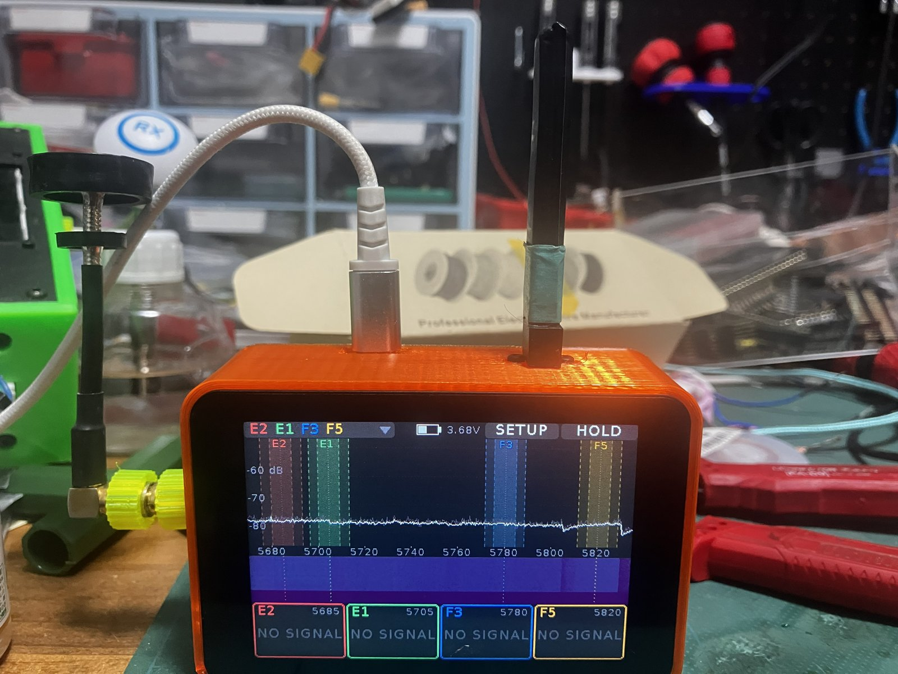
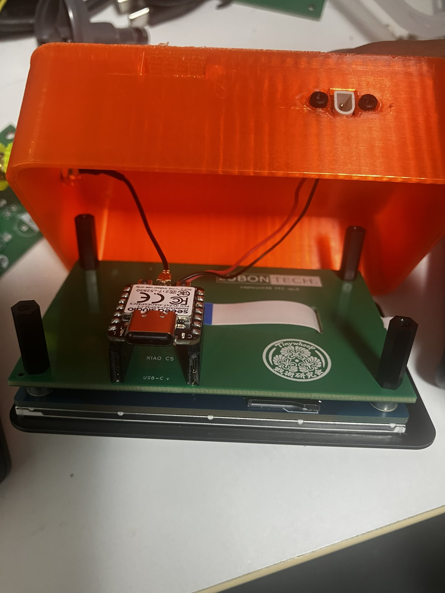
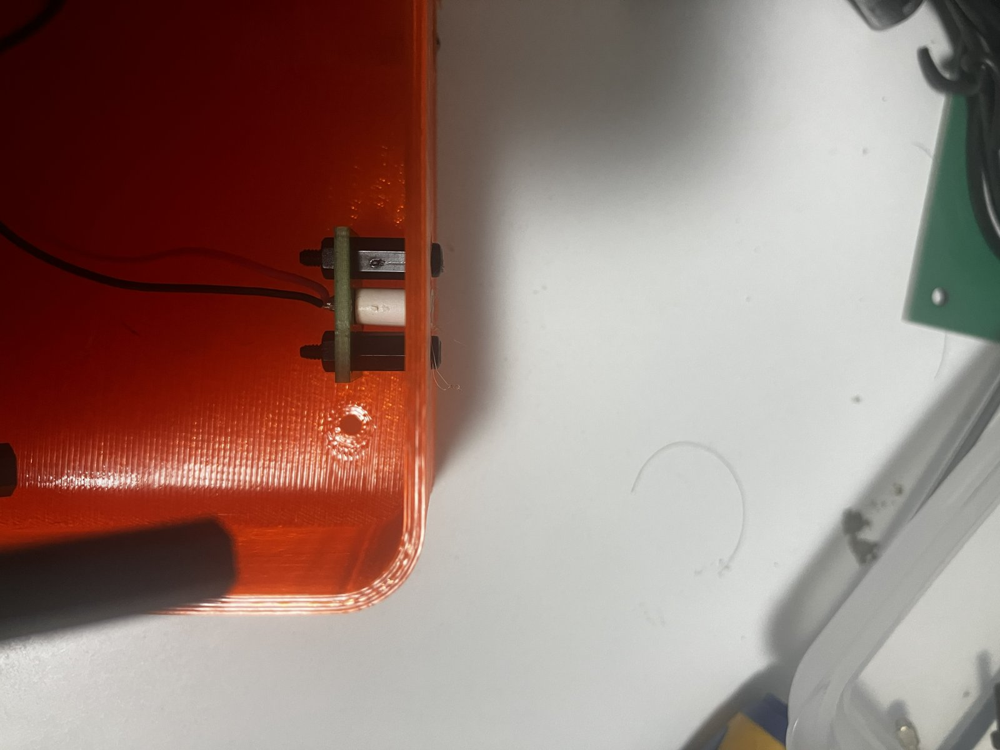
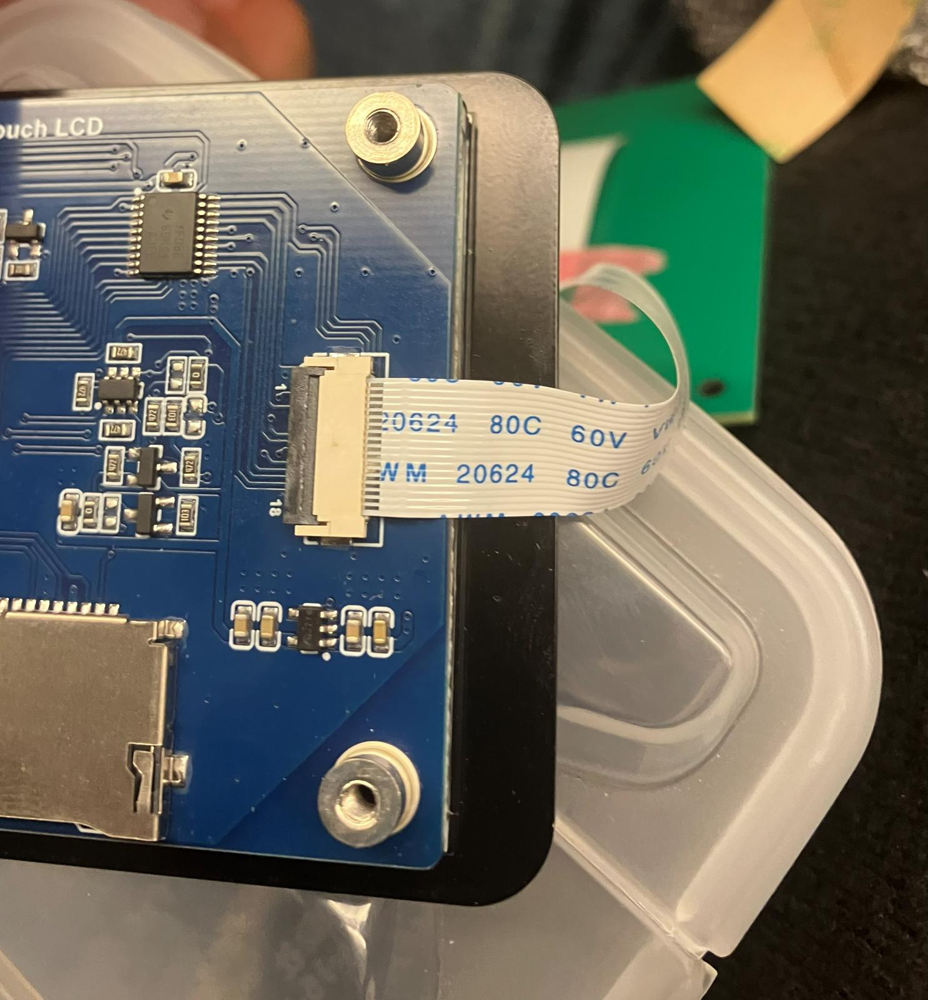
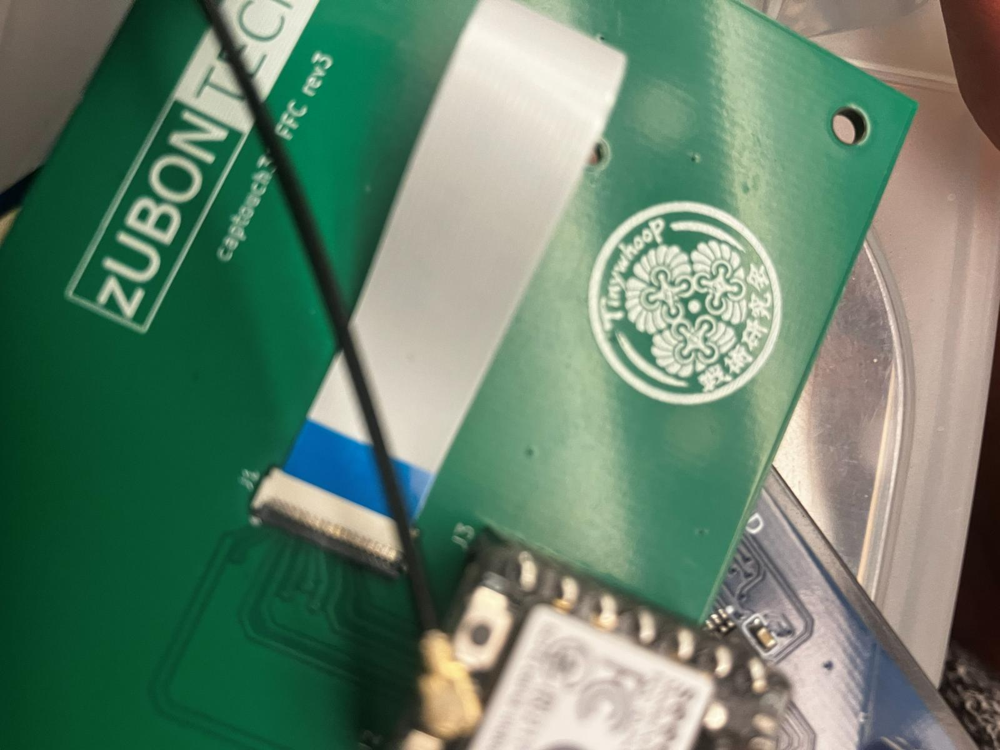

# FPV バンドモニタ 液晶版（XIAO ESP32-C5）

5.8 GHz のアナログ FPV 映像電波（FM-ATV）を、手のひらサイズの液晶で監視するバンドモニタです。
XIAO ESP32-C5 の Wi-Fi 受信機を SDR として使い（[ESP-SDR](https://github.com/ESPARGOS/esp-sdr) のフォーク）、
PC なしでスペクトラム・ウォーターフォール・各 VTX の実測中心周波数とずれを表示します。

- グループ監視（4CH / 4CH2 / 4CH3 / 3CH）と、1 チャンネルの拡大表示（1CH：グループ内のチャンネルを ±15 MHz で）
  - **4CH**（既定）：E2 5685 / E1 5705 / F3 5780 / F5 5820 MHz
  - **4CH2**：E1 5705 / A8 5725 / A5 5785 / F5 5820 MHz
  - **4CH3**：R2 5695 / F1 5740 / R4 5769 / R5 5806 MHz
  - **3CH**：E1 5705 / F1 5740 / F4 5800 MHz
  - バンド名：A = Boscam A、E = Boscam E、F = Fatshark（ImmersionRC）、R = Raceband
- VTX の中心周波数のずれを MHz で表示（±0.5 MHz 以内は青、1 MHz 未満は黄、それ以上は赤）
- グループごとの Wi-Fi チェック（**受信だけ**で、FPV チャンネルに Direct / IMD で効く Wi-Fi を探す）とグループ内の IMD 表示
- 電池駆動（低電圧で自動シャットダウン）、画面の 180 度回転、PC 版モニタとの USB 接続

使い方は **[操作マニュアル（MANUAL.md）](MANUAL.md)** を見てください。

## 写真

| ケースに入れて 4CH を表示しているところ | ケースの中：液晶の裏の本体基板（XIAO はピンソケットに挿す、FFC、スペーサー） | BT2.0 のサブ基板（ケースの背面に M2 スペーサーとねじで固定） |
|---|---|---|
|  |  |  |

### FFC ケーブルの表裏

| 液晶側のコネクタ：接点がある面が上（液晶基板の裏から見て） | 本体基板の J1 側：青い補強板がある面が上 |
|---|---|
|  |  |

## このリポジトリに入っているもの

| | 内容 | 場所 |
|---|---|---|
| 1 | **JLCPCB（JLCONE）にそのまま発注できる基板データ**（ガーバー・BOM・CPL） | [`hardware/captouch35_ffc/jlcpcb/`](hardware/captouch35_ffc/jlcpcb/) |
| 2 | **ブラウザからファームを書き込めるページ**（インストール不要） | https://zubon2003.github.io/fpv-lcd/ |
| 3 | **ケースの STL と寸法図（PDF）** | [`hardware/case.STL`](hardware/case.STL)、[`hardware/case_drawing.pdf`](hardware/case_drawing.pdf) |

### 1. 基板を JLCPCB（JLCONE）に発注する

液晶の裏に重ねる本体基板（FFC 版）です。KiCad 8 の基板と、発注に必要な 3 つのファイルを同梱しています。

| ファイル | 使う場所 |
|---|---|
| `captouch35_ffc_gerber.zip` | 基板の注文（Gerber のアップロード） |
| `captouch35_ffc_bom.csv` | PCBA（部品実装）の BOM |
| `captouch35_ffc_cpl.csv` | PCBA の CPL（部品の位置） |

1. JLCONE（アプリ）または jlcpcb.com で PCB の注文を開き、`captouch35_ffc_gerber.zip` をアップロードする（2 層、1.6 mm）。
2. PCB Assembly を ON にし、BOM と CPL をアップロードする。実装するのは **J1（FFC コネクタ、LCSC C2919497）の 1 点だけ**、片面（Top）。

参考価格（2026-11 の注文、5 枚とも J1 を実装）：PCB 5 枚 $1.91 + PCBA $14.27 + 送料 $8.80 = **$24.98**（1 枚あたり約 $5）。

ほかの部品（XIAO 用のピンソケット、BT2.0 コネクタ）は自分ではんだ付けします。
注文前の確認（原寸で印刷して液晶に重ねる）・結線・組み立ての注意は [`hardware/captouch35_ffc/README.md`](hardware/captouch35_ffc/README.md) にあります。

### 2. ファームを書き込む（ブラウザ）

**https://zubon2003.github.io/fpv-lcd/** を パソコンの Chrome か Edge で開き、「書き込む」を押すだけです。

1. XIAO ESP32-C5 を USB-C でパソコンにつなぐ。
2. 「書き込む」を押し、XIAO のポートを選ぶ。
3. 終わったら XIAO の RESET を 1 回押す。

つながらないときは、XIAO の BOOT を押したまま RESET を押して離し、BOOT を離してからやり直します。
「消去してから書き込む」を選ぶと保存した設定が消えます（ふつうは消去しなくてよい）。

### 3. ケース

**ケースは、寸法図と手元の部品（液晶・基板・電池・SMA）の寸法を確かめながら、自分で設計することをおすすめします。**
ここの STL は作者の部品に合わせた一例で、部品の個体差や電池の選び方によっては合いません。
XIAO は秋月の分割ロングピンソケット（105779）で基板に付ける前提の高さです（ピンヘッダーを直接はんだ付けした場合は合わせ直す）。

- [`hardware/case.STL`](hardware/case.STL)：作者が使っているケース（参考。SolidWorks から書き出し、単位 mm）。外形 96.44 × 65 × 30.38 mm。
- [`hardware/case_drawing.pdf`](hardware/case_drawing.pdf)：寸法図（A3・1:1・第三角法）。天板の 4 穴（液晶の M2.5 穴と同じ間隔 73.84 × 45.58）、
  USB の切り欠き、BT2.0 の穴、SMA の穴の位置と大きさ。

## 必要なもの

| 部品 | 備考 |
|---|---|
| Seeed Studio XIAO ESP32-C5 | 付属のピンヘッダーを XIAO にはんだ付けする |
| 分割ロングピンソケット 1×42（秋月電子 [105779](https://akizukidenshi.com/catalog/g/g105779/)、FHU-1x42SG） | 7 ピンずつ 2 本に切って基板に付け、XIAO を挿す。ケースの寸法はこのソケットで XIAO を付ける前提。ソケットを使わず、XIAO のピンヘッダーを直接基板にはんだ付けしてもよい（XIAO が低くなるので、USB の切り欠きなどケースの高さを合わせる） |
| Waveshare 3.5inch Capacitive Touch LCD（SKU 29318） | 320×480 IPS、ST7796S + FT6336U |
| 本体基板（上の JLCPCB 発注分） | J1 は実装済みで届く |
| FFC ケーブル 18 ピン 0.5 mm ピッチ、長さ 50 mm（長くてもとりあえず大丈夫） | 接点タイプは A / B どちらでもよい（J1 が両面接点のため） |
| M2.5 六角スペーサー 長さ 15 mm、片側オスねじ・片側メスねじ × 4 | 液晶と基板の固定。オス側は液晶のメスねじへ、メス側はケースを留めるねじ用 |
| M2.5 プラスチックねじ × 4 | ケースをスペーサーのメス側に留める |
| U.FL – SMA / RP-SMA（パネル取り付け）ピグテール、5.8 GHz アンテナ | 手持ちのアンテナに合わせて SMA か RP-SMA を選ぶ。XIAO ESP32-C5 付属のアンテナを使う場合は不要 |
| リチウムイオン / リポ 1 セル、BT2.0 コネクタ | 電池駆動する場合（1 セル以外はつながない） |
| M2 六角スペーサー 6 mm × 2、M2 ねじ | BT2.0 のサブ基板（M2 穴 2 つ）の固定 |
| ケース | 寸法を確かめて自分で設計するのがおすすめ（STL は参考） |

ピン配置は `main/fpv/fpv_config.h` の `FPV_PANEL_CAPTOUCH35` と同じで、基板を使えば配線は不要です。
ジャンパ線でつなぐ場合の結線図：[captouch35.html](https://zubon2003.github.io/fpv-lcd/wiring/captouch35.html)。

## もっと詳しく

- [MANUAL.md](MANUAL.md)：操作マニュアル（画面の見方、タッチ操作、Wi-Fi チェック、セットアップ、電池）
- [README-fpv-lcd.md](README-fpv-lcd.md)：技術資料（配線、USB コマンド、ビルド方法、PC 版との違い、速度）
- [hardware/captouch35_ffc/README.md](hardware/captouch35_ffc/README.md)：基板の結線・部品・組み立て
- PC 版モニタ：[zubon2003/fpv-band-monitor-c5](https://github.com/zubon2003/fpv-band-monitor-c5)
- 元の ESP-SDR の説明：[README-esp-sdr.md](README-esp-sdr.md)

## ビルド（開発者向け）

ESP-IDF（ESP-SDR が固定している版、`firmware-targets.json` の esp32c5）と LovyanGFX 1.2.32 が必要です。

```
git clone https://github.com/lovyan03/LovyanGFX components/LovyanGFX
git -C components/LovyanGFX checkout e2cc321
idf.py -B build-fpvcap -D FPV_LCD_MONITOR=ON -D FPV_PANEL=CAPTOUCH35 -D SDKCONFIG=build-fpvcap/sdkconfig \
  -D SDKCONFIG_DEFAULTS="sdkconfig.defaults;sdkconfig.defaults.esp32c5;sdkconfig.defaults.fpv-lcd" \
  set-target esp32c5 build
```

`-D FPV_LCD_MONITOR=ON` を付けなければ元の ESP-SDR になります。

## ライセンス

ESP-SDR が GPL-3.0 なので、このファームも GPL-3.0 です。LovyanGFX は FreeBSD ライセンスです。
